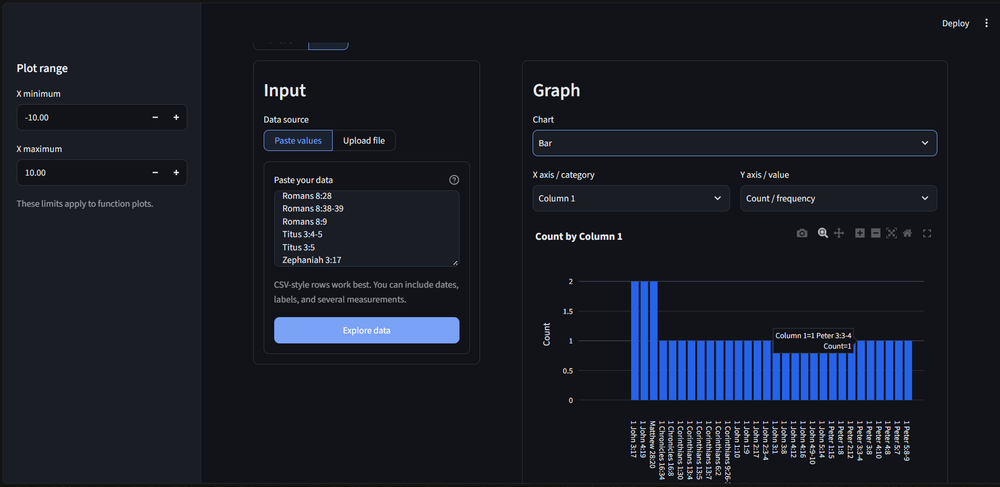

# AXION
### Universal Graph Analyzer & Plotter

**Turn equations and raw data into meaningful graphs.**

AXION is a Python-based graph plotting and analysis application built to make mathematical visualization easier. Enter an equation, provide coordinate points, or upload an experimental dataset, and AXION helps you visualize and understand the results.

The idea is simple: spend less time manually plotting graphs and more time understanding what they tell you.

## What can AXION do?

- **Function Plotting:** Plot linear, quadratic, polynomial, exponential, logarithmic and trigonometric functions.
- **Multiple Equations:** Visualize and compare multiple functions on the same graph.
- **Coordinate Plotting:** Enter coordinate points and generate graphs instantly.
- **Data Analysis:** Upload CSV, Excel, JSON and other supported datasets.
- **Automatic Charts:** Get chart suggestions based on your dataset.
- **Mathematical Analysis:** Calculate roots, intercepts, derivatives, extrema and approximate areas.
- **Statistical Analysis:** Explore correlation, regression and R² values.
- **Interactive Graphs:** Zoom, pan, hover over coordinates and explore your visualizations.
- **Export:** Save graphs and download processed data.

## Built With

| Technology | Purpose |
|---|---|
| Python | Core programming |
| Streamlit | User interface |
| SymPy | Symbolic mathematics |
| NumPy & SciPy | Numerical computation |
| Pandas | Data processing |
| Plotly | Interactive visualization |

## Getting Started

### 1. Clone the repository

```bash
git clone https://github.com/Shuvamm939-glitch/GRAPH.git
cd GRAPH
```

### 2. Create a virtual environment

**Windows:**
```powershell
python -m venv .venv
.venv\Scripts\activate
```

**Linux / macOS:**
```bash
python3 -m venv .venv
source .venv/bin/activate
```

### 3. Install dependencies

```bash
python -m pip install -r requirements.txt
```

### 4. Run AXION

```bash
python -m streamlit run ui/app.py
```

The application will open in your browser.

## Project Structure

```text
GRAPH/
├── graph_analyzer/
│   ├── analysis.py
│   ├── data_engine.py
│   ├── exporting.py
│   ├── math_engine.py
│   ├── parser.py
│   └── plotting.py
├── ui/
│   └── app.py
├── requirements.txt
└── README.md
```

## A Note on Accuracy

AXION uses symbolic and numerical methods depending on the problem. Some results, such as roots, extrema and areas, may be approximations calculated over the selected graph range. These limitations are important, especially when working with scientific or experimental data.

## What's Next?

AXION is an evolving project. The goal is to expand its mathematical capabilities, improve automatic graph detection, introduce more scientific visualization tools and make complex analysis easier to understand.

Contributions, suggestions and feedback are welcome.

---

**AXION — Beyond Equations. Into Insights.**

Built with Python.


## Preview

### 1. Mathematical Graph Plotting
Plot mathematical equations and explore interactive visualizations with automatic mathematical analysis.

 

### 2. Scientific Data Analysis
Upload experimental datasets, generate graphs, and explore regression, statistical calculations, and analytical results.

<p align="center">
  
</p>
